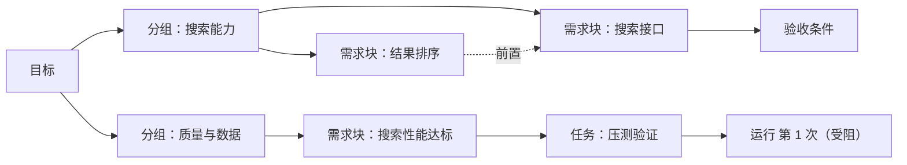
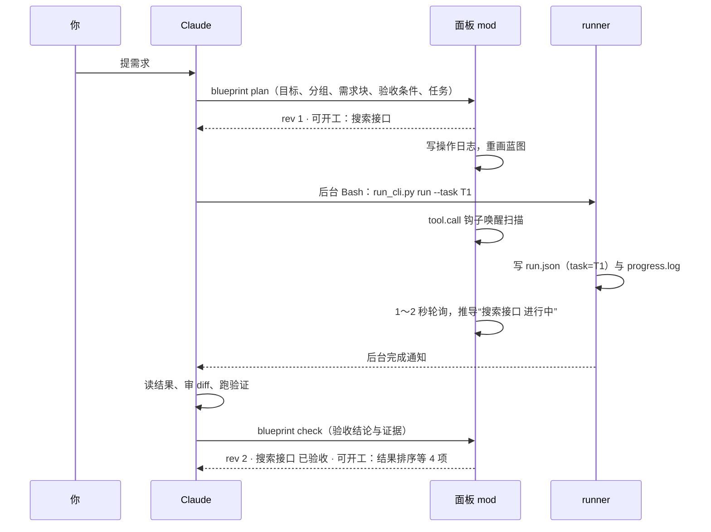

# 需求拼图 · 桌面端方案（第二版）

- 日期：2026-11-03
- 状态：方案建议，**未实施**
- 范围：只做桌面 App 的开发与适配（App 内置 Claude Code 2.1.309）
- 依据：
  - 2.1.309 自带的 Mods 类型定义与参考文档，以及一组临时探针测试；
  - 仓库里 `delegate-cli`、`delegate-cli-panel` 的现状；
  - [动态蓝图需求](delegate-cli-dynamic-blueprint.md)；
  - 你对第一版原型的反馈。
- 配套：第二版交互原型在对话里，是 HTML 近似，不是真实面板渲染

## 修订记录

| 版本 | 主要内容 |
| --- | --- |
| 第一版（调研稿） | 原生拼图板为主，SVG 封面与关系图为辅；卡片按依赖分层；底部固定检视条；凹凸代表关系 |
| 第二版（本稿） | 按“默认看需求、悬停看执行、点击看详情与处理”重排信息层级；先收层级，再调视觉 |

第二版相对第一版的改动：

| 第一版 | 第二版 |
| --- | --- |
| 左侧九条执行记录，和右侧状态一样醒目 | 对话照常；插件生成的派发、续接、完成合并成一行可展开的动态 |
| 顶部六种状态计数，外加两种进度（1/6、3/11） | 顶部只留“已验收 x / y 项需求”和“需关注”；验收条件的通过数只在详情里 |
| 四个大视图按钮（拼图板、关系图、清单、封面） | 右上角三个小切换（蓝图、清单、关系）；封面并入标题下的一句简介 |
| 卡片按依赖分成“第 1 层、第 2 层” | 按需求的组成分组，位置固定；依赖只在悬停、关系视图和详情里出现 |
| 底部固定检视条，混着模型、运行信息、更新时间 | 悬停时在块旁浮出紧凑预览；完整信息放进点击后的详情 |
| 凹凸代表关系，要另外解释 | 凹凸至多是可选外观，不承载关系；关系只有“前置 / 后续”一种 |
| 编号（R1、T3）、层号、“接口咬合”等术语出现在界面上 | 界面只用业务名称；编号只给 Claude 和工具内部用 |
| “性能压测”这类活动当成需求块 | 需求块写成结果（“搜索性能达标”），活动作为它下面的任务 |

---

## 0. 结论先行

1. **核心是信息层级，不是画法。** 先收层级，再调颜色、圆角和发光：
   - 平时看完整需求；
   - 悬停看谁在做、做到哪里；
   - 点击看具体内容与处理入口。
2. **主体是用原生元素搭的需求蓝图。** 块按需求的组成分组，位置固定；状态变化只换块上的标识，让你始终记得“这一块在哪里”。
3. **拼图感来自整体、缺口、关联和完成感，不来自凹凸：**
   - 已验收的块铺上底色，表示“拼上了”；
   - 待澄清的块是虚线框，表示“还缺这一块”；
   - 悬停时能找到它的前置和后续。
4. **多种形式保留，但退到轻量入口：** 蓝图（默认）、清单、关系。
5. **执行历史降权：** 插件生成的记录合并成可展开的简短动态，点一条能定位到对应的块。
6. **“需关注”只列需要你处理的事**，判断标准是“下一步该谁动手”，不看问题有多严重。
7. **写入分工不变：**
   - Claude 写意图与结论（面板注册的 `blueprint` 工具）；
   - runner 写运行事实（只加一个可选参数 `--task`）；
   - 面板负责推导状态和展示。
8. **保留不变的部分：**
   - 六种状态、验收记录、多 Agent、依赖、多种呈现形式；
   - “执行结束”和“验收通过”继续分开；
   - 撰写、派发、续接、审查、验收的流程都不动，只重新安排什么时候看到什么。

---

## 1. 三层信息

### 1.1 默认：一张稳定的需求蓝图

默认界面只回答四件事：
- 这件事要实现什么？
- 由哪些部分组成？
- 各部分处于什么状态？
- 哪里有缺口或阻碍？

| 区域 | 放什么 |
| --- | --- |
| 头部 | 目标名称；一句简介（原来的“封面”）；总体指标“已验收 1 / 6 项需求”；“需关注 2 项：压测环境访问受阻；空结果推荐规则待明确”，每项可点，点了定位到对应的块 |
| 主体 | 按组成分组的需求块。每块只放：名称、一句必要的说明、小状态标识。需要你处理的块，说明行直接换成具体原因（如“缺压测环境访问账号”） |
| 不常驻 | Agent 详情、模型、运行次数、验收明细、日志、编号、层号、实现术语 |

### 1.2 悬停：让执行信息浮现

- **块旁浮出紧凑预览**，四行就够：

  ```
  结果排序
  Codex · 实现中
  当前：修复 2 个失败测试
  前置：搜索接口 已验收
  ```

- **只有当前块最突出**：
  - 当前块出现柔和的光圈；
  - 直接相关的前置、后续块边框略加深，并带一个“前置”或“后续”小标签；
  - 其他块保持安静。
- **预览不挡住相关块**：在“旁边、下方、上方”里挑一个遮住相关块最少的位置。
- **移开就收起。** 键盘聚焦到一块时显示同一份预览，不依赖鼠标。
- 模型名不放进预览，在详情的运行记录里能看到。

### 1.3 点击：进入稳定的详情

- 选中的块左侧出现一道深色竖条，作为稳定标记，位置不变。
- 详情在蓝图下方展开，内容依次是：
  - 需求说明、范围与边界；
  - 验收条件及通过情况（“x / y”只在这里出现）；
  - 负责实现、审查或验证的 Agent；
  - 运行记录（含失败和续接），点一条打开「子 Agent」窗格里那次运行；
  - 前置与后续，以及受阻原因；
  - 相关产物；
  - 处理入口。
- 处理入口随状态变化，**都只把文字填进输入框，不自动发送、不启动执行**：

  | 状态 | 处理入口 |
  | --- | --- |
  | 受阻（要你处理） | 提供访问方式 |
  | 待澄清 | 回答这个问题 |
  | 待验收 | 请 Claude 验收 |
  | 进行中 | 停止运行（两次确认） |
  | 任何状态 | 追问这一块 |

悬停是快速看一眼，点击是停下来理解或处理。

### 1.4 视觉手段分工：一种手段只表达一种含义

| 含义 | 手段 |
| --- | --- |
| 状态 | 小圆点加文字：已验收（绿）、进行中（橙）、待验收（紫）、等待前置（灰）、受阻（红）、待澄清（琥珀） |
| 完成 | 已验收的块铺浅底色 |
| 缺口 | 待澄清的块用虚线框 |
| 悬停 | 柔和光圈（原生做法是边框变色加淡底色，见 4.2） |
| 关联 | 边框略加深，加“前置 / 后续”小标签，只在悬停时出现 |
| 选中 | 左侧深色竖条 |

### 1.5 线框（面板约 48 列宽）

默认：

```
商品搜索上线                                   蓝图  清单  关系
用户能按关键词找到商品、按相关度排序，搜不到时也有推荐。
已验收 1 / 6 项需求
需关注 2 项：压测环境访问受阻；空结果推荐规则待明确

搜索能力
  [搜索接口        ● 已验收]（铺底色）  [结果排序        ● 进行中]
   按关键词返回商品列表                   按相关度和销量排序
搜索体验
  [搜索页面      ● 等待前置]            [空结果推荐      ● 待澄清]（虚线）
   搜索框、结果列表和分页                 待明确：搜不到时推荐什么
质量与数据
  [搜索埋点        ● 待验收]            [搜索性能达标      ● 受阻]
   记录查询和点击                         缺压测环境访问账号
```

悬停“结果排序”：它出现光圈；“搜索接口”带“前置”标签，“搜索页面”带“后续”标签；预览浮在“结果排序”下方，只盖住无关的“空结果推荐”。

点击“搜索性能达标”：它左侧出现竖条，蓝图下方展开详情，处理入口是“提供访问方式”和“追问这一块”。

---

## 2. 拼图的构成

### 2.1 拼图感从哪里来

| 特征 | 在界面上 |
| --- | --- |
| 整体性 | 所有块在同一张蓝图上，按组成分组，共同组成一个目标 |
| 缺口感 | 待澄清的块是虚线框；“需关注”写明缺什么 |
| 关联性 | 悬停一块时，它的前置和后续被轻轻点亮 |
| 完成感 | 已验收的块铺上底色；同一张蓝图随着推进逐渐补齐 |

凹凸轮廓不承载关系。如果以后要做拼图外观，所有块用统一的凹凸规律，不让人去读它的含义。关系只通过悬停提示、关系视图和详情表达，这样文字版、卡片版、拼图版共用一套含义。

### 2.2 结构



- **目标 → 分组 → 需求块 → 任务 → 运行**：续接、重试、换 Agent 都新增运行，块和任务的身份不变（沿用蓝图 §3.1）。
- **验收条件挂在块上**：只有主控能判“过”或“不过”，并附上证据。

### 2.3 怎样算一块（Claude 拆分时遵守）

- **同一层级的“结果”**：写“应该成立什么”，比如“搜索性能达标”；不写活动，比如“性能压测”。活动是块下面的任务，实现、测试、审查都挂在块下面。
- **能独立验收**：至少 1 个验收条件，写得出“怎样算过”。
- **一条任务链能做完**：实现、审查、验收，1 到 3 次运行。
- **规模**：一个目标 3 到 9 块；更多就多分几组，每组 2 到 4 块；超过 30 块应拆成两个目标。
- **拿不准就留“待澄清”**，写清问题，不硬拆。

### 2.4 分组与位置

- 块按**需求本身的组成**分组（如搜索能力、搜索体验、质量与数据），由 Claude 规划时定。
- 组内顺序固定。新增的块追加到所在组末尾。
- 状态变化、悬停、选中、需求修订都**不挪位置**。
- 依赖**不决定位置**：第一版的“按依赖分层”作废，依赖只在悬停、关系视图和详情里出现。
- 切分口径（按用户价值、按模块、按用户流程、按验收项）由 Claude 按任务选，不在界面上单独标注，分组名本身就说明了怎么切。

### 2.5 关系

- 结构化关系只有一种：**前置 / 后续**，即“开工前要先完成”。
- 共用接口这类说明，写成详情里的文字，不做成另一种可视关系。
- 一个任务服务多块时（如一次审查覆盖两块），它出现在每块的详情里。
- 证据挂在验收条件上：文件、截图、运行目录、测试输出。

### 2.6 状态由面板推导，Claude 不手写

每块显示一个主状态，其余作为副标记。从上往下优先：

| 条件 | 显示 |
| --- | --- |
| 当前版本的验收条件全部通过 | 已验收 |
| 曾经验收过，之后需求版本变了 | 需复验 |
| 某任务最新运行是 blocked / failed / timed_out，或被标记受阻 | 受阻（附原因） |
| 有验收条件判为不过 | 需修复 |
| 有任务的最新运行在跑，心跳正常 | 进行中（附当前活动） |
| 在跑但心跳超时 | 待核实（保留最后已知状态） |
| 运行都正常结束，验收条件还没判完 | 待验收 |
| 有未答问题，或还没有验收条件 | 待澄清 |
| 前置块还没验收 | 等待前置 |
| 其他 | 未开始 |

### 2.7 需关注：只列要你处理的事

判断标准是“下一步该谁动手”，不看问题有多严重。

| 进“需关注” | 不进“需关注”（只体现在块的状态和悬停预览里） |
| --- | --- |
| 缺权限或账号（如压测环境访问） | 正在修的失败测试 |
| 需要你明确规则、回答问题（如空结果推荐什么） | 锁冲突，改成串行就行 |
| 需要你在几个方案里做决定 | 写错了的模型名 |
| 需要你授权（如目录信任、提交） | 临时网络问题，续接即可 |

- **升级**：自己能处理的问题反复处理不掉、需要你拿主意时，Claude 把它明确转成“需要你决定”的问题，这时才进“需关注”。
- **数据上**：每个问题、每个阻碍都标明谁来处理（你，或 Agent / Claude）。
- **runner 的受阻和失败原因按类别映射**：
  - 归你处理：目录信任、认证、额度；
  - 归 Agent / Claude 处理：锁冲突、模型名写错、非 Git 目录、网络。

### 2.8 进度口径

- 头部只有一个总体指标：已验收 x / y 项需求。
- 验收条件的 x / y 只在详情里出现。
- 不出百分比。耗时、token、心跳只用来判断信息新不新鲜。

---

## 3. 呈现形式与对话

### 3.1 三种形式，一个轻量入口

| 形式 | 用途 |
| --- | --- |
| 蓝图（默认） | 理解全貌、查看当前状态 |
| 清单 | 紧凑阅读、逐项核对；也是纯文字环境下的表达 |
| 关系 | 看“为什么要等”、某个阻碍会影响哪些部分 |

- 切换入口是右上角三个小字，当前项用浅底色标出。
- 原来的“封面”并入标题下的一句简介，不再是一个视图。
- 依赖简单时，靠悬停看直接关系就够，不必切视图。
- 你切过的视图会记住，存在 `$.store`。

### 3.2 关系视图用缩进列表，不画图

```
搜索接口                          ● 已验收
  ↳ 结果排序                      ● 进行中
      ↳ 搜索页面                  ● 等待前置
        也需要：搜索接口
  ↳ 空结果推荐                    ● 待澄清
  ↳ 搜索埋点                      ● 待验收
  ↳ 搜索性能达标                  ● 受阻
```

- 后续块缩进挂在前置块下面；有多个前置时，写一行“也需要：…”。
- 用原生元素画，能点、能用键盘，和文字版是同一套含义。
- 桌面端的 SVG 图里点击传不出来，所以 SVG 关系图只作为以后可选的只读增强。

### 3.3 对话里的拼图动态

- 普通对话照常。
- 插件生成的派发、续接、完成、受阻，合并成一行“拼图更新 · N 条”，默认收起。
- 展开后每条一行：悬停一条，对应的块亮起并浮出预览；点一条，定位到那块并展开详情。
- 这一行替代 SKILL 里要求手贴的派发卡片表格，不再花模型 token。
- 合并多行是否可行要实测（V5）。不行就退一步：每条插件行画成一行灰色小字，同样能悬停、能点。

### 3.4 宽度适配（按 `bodyColumns`）

- 不到 40 列：强制清单。
- 40 到 70 列：每组每行 1 到 2 块。
- 超过 70 列：每组每行最多 3 块。

---

## 4. 桌面端能力与实现要点

### 4.1 能力清单（以 2.1.309 类型定义为准）

| 能力 | 桌面端现状 | 用在哪 |
| --- | --- | --- |
| 元素 | `Box` `Text` `Button` `Input` `Select` `Svg` `Link` `Code` `Markdown` `Client` | 终端没有 `Svg`，VS Code 没有 `Client`；桌面端能力最全 |
| 悬停 | `Box`/`Text`/`Button` 可设 hover 样式（边框样式与颜色、底色、文字样式）；`scope` 把任意位置的元素编成一组，一个被悬停整组都亮；`display:none` 配合 hover 可显隐；绝对定位不挤动周围 | 光圈、关联提示、块旁预览，都不经过插件、不调模型 |
| 焦点 | 焦点移动会触发 `ui.focus` 事件 | 键盘聚焦时显示同一份预览 |
| `Svg` | 传入 SVG 文本（不超过 131,072 字符）；默认按图片画；`isInteractive` 时放进无脚本沙盒框，CSS `:hover`、动画、`<title>` 提示可用；**图里的点击传不出来** | 只留给以后可选的只读关系图 |
| `Client` | 绘制线程上的模块，有本地状态、指针和键盘事件，能 `post` 回插件；只能画文字类元素 | 暂不用；块多到要平移、要复杂键盘导航时再考虑 |
| 注册工具 | `$.tool.register` 注册成 `mcp__<插件>__<名>`，JSON Schema 入参，插件的 `tool.call` 钩子作答；可放在 ToolSearch 后按需加载 | Claude 维护拼图的 `blueprint` 工具 |
| 重绘对话行 | `ToolUse`、`UserMessage`（含后台任务完成通知）、`CommandOutput` 等可由插件画自己的树 | 对话里的拼图动态 |
| 窗格 | `$.ui.open` 按 id 开，多个窗格成标签页；可请求列宽；插件自己发起的打开可能被挂起 | 「需求拼图」窗格 |
| 状态与存储 | `$.state` 会话内（带 `shape` 版本）；`$.store` 跨会话；`$.fs` 能读写，但**不能监听** | 刷新靠事件唤醒加定时轮询 |
| 系统提示 | `prompt.compose` 可追加会话级段落；内容一变，后面整段对话的提示缓存都要重建 | 只放稳定约定，不放实时状态 |
| 提醒 Claude | 拦截 `tool.call` 后可在结果上附 `context`：Claude 能读，你看不到 | 派发没带 `--task` 时私下提醒 |

### 4.2 三层在原生元素上怎么做

| 设计 | 原生做法 |
| --- | --- |
| 悬停光圈 | 卡片是带 key 的 `Box`，hover 时改边框颜色（必要时换粗一档的边框样式）并加淡底色。原生卡片**没有阴影类属性**，做不出真正的柔光，这是能做到的最近似效果 |
| 关联提示 | 每块的 ID 是一个 hover 分组。B 的卡片里，为每个与它相关的块 A 预先画一个隐藏的覆盖层（带“前置 / 后续”标签和加深的边框），加入 A 的分组；悬停 A 时，这些覆盖层一起显示 |
| 块旁预览 | 预览是卡片内绝对定位的隐藏 `Box`，加入本块分组，悬停时显示，不挤动布局；位置由插件绘制时按格子算好，选遮住相关块最少的一侧。对话动态行也在同一分组，悬停它也会在块旁浮出预览 |
| 键盘聚焦 | 监听 `ui.focus`，记下聚焦的块，重画时让它的预览常显 |
| 选中标记 | 点击（`Button` 的 press）记下选中的块并重画：卡片左侧画一个 1 格宽、有底色的绝对定位 `Box` 作竖条，下方展开详情 |
| 完成与缺口 | 已验收卡片设底色；待澄清卡片用虚线边框样式 |
| 需关注 | 头部每一项是一个无边框的 `Button`，点了定位并选中对应的块 |

主题色只有固定的一组 key（`success`、`error`、`warning`、`claude` 等），没有“面板底色”这类 key。预览底色和已验收块的底色在明暗主题下效果如何，要实测（V2）。

### 4.3 探针测试（已跑，5/5 通过）

在临时目录写了一个一次性小 mod（不在仓库里，也不在 `dev-mods`），用 App 内置 2.1.309 跑 `plugin validate` 和 `plugin test`：

| 测试 | 结果 |
| --- | --- |
| 桌面端接受：带 `isInteractive` 的 `Svg`、带 `scope` 的 hover、悬停显隐卡片、`Client`（指针、`post`、插件回送 props） | 通过 |
| 终端没有 `Svg` 时走降级分支 | 通过 |
| 对照组：`Button` 里放 `Box` 会被拒绝（证明校验是真的在跑） | 通过 |
| 插件工具的对话行可以重绘，并和面板同属一个 hover 分组 | 通过 |
| `session.start` 时注册工具，插件能回答调用 | 通过 |

测试工具只校验“交给界面的元素描述”，不校验真实画面，观感要到 App 里实测。

---

## 5. 更新机制

### 5.1 谁写什么（每类数据只有一个写入者）

| 数据 | 写入者 | 存放 |
| --- | --- | --- |
| 目标、分组、需求块、验收条件、前置关系、任务 | Claude，通过 `blueprint` 工具 | 拼图操作日志 |
| 待澄清问题、非运行原因的受阻（都标明谁来处理） | Claude，通过 `blueprint` 工具 | 拼图操作日志 |
| 验收结论与证据 | Claude，通过 `blueprint check` | 拼图操作日志 |
| 运行状态、活动、日志、结果 | runner | `run.json`、`progress.log`（现状不变） |
| 块状态、总体指标、需关注、可开工、对话动态 | 面板推导 | 不落盘，只在内存和 `$.state` |

### 5.2 数据流



### 5.3 存储：操作日志加快照

- `~/.claude/cli-runs/blueprints/<会话ID>.jsonl`：只追加的操作日志，每次工具调用一行，带 `rev`。
- `~/.claude/cli-runs/blueprints/<会话ID>.json`：由日志算出的快照，用于快速加载。

用日志的好处：
- 修订记录天然就有；
- “需复验”能按版本判断；
- 写到一半中断也不会坏掉整份文件；
- 恢复会话、重载插件时，重放日志就能重建。

面板扫描运行目录用的正则只匹配运行目录名，`blueprints/` 子目录不会干扰现有扫描。

### 5.4 刷新节奏

- **事件唤醒**：`blueprint` 工具调用后立即更新；派发的 Bash 调用会唤醒扫描（现有逻辑）。
- **定时**：沿用现状。打开着的运行在跑时每 1 秒，有在跑的运行时每 2 秒，空闲约 10 秒。
- **重建**：会话恢复、插件重载、面板重开时，从操作日志和运行目录重建。加载中、缺失、过期、已确认几种情况分开显示。

### 5.5 runner 的最小改动

- 新增可选参数 `--task <任务ID>`，写进 `run.json` 的 `task` 字段。
- `--resume-from` 续接时，没传 `--task` 就沿用上一次的。
- 其他行为不变。

为什么不只做文档建议的“旁侧映射”：后台派发时，Claude 要等完成通知才拿得到 `run_file`，运行期间这次运行无处归属；`run.json` 又没记原始任务文件路径，事后也对不上。关联 ID 要在发起时带上。

### 5.6 `blueprint` 工具草案

| 操作 | 作用 | 典型时机 |
| --- | --- | --- |
| `plan` | 建立整份蓝图（目标、简介、分组、需求块、任务），或整体替换 | 理解需求后 |
| `piece` | 增改一块：名称、说明、所属分组与顺序、范围、验收条件、前置。改说明或验收条件会升版本 | 需求修订 |
| `task` | 增改任务：所属块、角色、Agent、先后 | 派发前 |
| `ask` / `answer` | 记下或关闭待澄清问题（默认归你处理） | 缺信息时 / 你回答后 |
| `check` | 逐项记验收结论与证据 | 收回结果并验证后 |
| `block` | 标记或解除非运行原因的受阻，并标明谁来处理 | 缺账号、等外部时 |
| `get` | 读一块或整份蓝图的紧凑文本 | 上下文被压缩后找回 |

- 每次调用返回一行，例如：`rev 8 · 搜索埋点 → 已验收 · 可开工：搜索页面 · 需关注 1 项`。“可开工”和“需关注”由面板算好告诉 Claude，Claude 不用再推一遍。
- ID 由 Claude 指定，操作是幂等的，重试不会重复。编号只在工具和日志里用，界面上不出现。
- 出错（未知块、前置成环、ID 重复）时返回错误文字，不写入。
- 默认放在 ToolSearch 后面，用到拼图的会话才加载，平时不占提示词。

---

## 6. 为什么这样最符合我（Claude）的习惯与生态

- **我擅长结构化工具调用**：有 schema、有校验、按 ID 增量改，出错率低。整份长 JSON 重写会漂移、费 token；在 shell 里拼带引号的 JSON 也容易出错。
- **我看不见面板**：状态必须能由机器推导，我只提供意图和判断。面板用一行字告诉我现在可以开工什么、需关注有几项，我据此决定下一步。
- **我靠通知，不靠轮询**：后台完成通知到了，我验收，再用一次工具调用记下结论，节奏和现在的 SKILL 一致。
- **“需关注”由我在记录问题和阻碍时标明归属**：它准不准，取决于我能否诚实区分“我能处理”和“需要你”。处理不掉时我主动升级，不把所有异常都推给你。
- **省 token**：一次工具调用大约一百个 token；面板画蓝图、对话动态都不花模型 token，比我每次重写一份 Markdown 清单便宜，也不会写错状态。
- **和桌面端已有界面各管一件事**：
  - 我自己的“计划清单”是本轮要做的步骤；
  - 拼图是跨轮次、跨 Agent 的需求地图，两者不合并；
  - Background tasks 看原始输出，「子 Agent」看单次运行，拼图看全局。
- **Claude Code 生态里的分工**：
  - Skill 写流程：什么时候拆、怎么验收、何时升级为需关注；
  - Mod 提供工具和界面；
  - runner 负责执行；
  - 钩子负责提醒：派发没带 `--task` 时，面板给我一条只有我看得见的提示。

---

## 7. 兼容与扩展

1. **数据契约和界面分开**：操作日志和快照是唯一数据源。以后要做 Artifact、浏览器页或终端视图，都读同一份。
2. **版本**：快照带 `schema`，新增字段向后兼容；面板的 atom 沿用 `shape` 标签，旧值自动作废。
3. **旧数据**：没有 `task` 的运行，放进蓝图底部一个默认收起的“未归属的运行”；现有「子 Agent」窗格原样保留。
4. **引擎版本漂移**：Mods 仍是早期 API（参考文档原话是 “early access and moves between releases”）。
   - 以安装版的类型定义为准；
   - 测试用 App 内置的 `claude` 跑（PATH 上的 2.1.156 没有 `plugin test`）；
   - 用到的能力先判断存在再用。
5. **没装面板时**：Skill 只在聊天里给文字清单（与清单视图同一套含义），不写拼图文件。
6. **会话生命周期**：
   - 恢复会话沿用同一个会话 ID，日志直接接上；
   - 分叉出的新会话提供“导入上一会话的拼图”；
   - 上下文压缩不影响拼图，因为日志在文件里。
7. **规模**：多于 9 块就多分组，组可折叠；单棵树的文字上限是 10 万字符，离得很远，主要关注重绘频率。
8. **以后可以接的扩展点**：
   - `blueprint` 生成交接片段，把块的验收条件自动写进给 Codex、Pi、Cursor 的任务文件；
   - GUI 验收的截图路径直接挂到验收条件上作证据；
   - 提交信息的 trailer 增加 `Puzzle-Piece`，和现有的 `Agent-Run` 并列；
   - 可选的拼图外观（统一凹凸，不带含义）和只读 SVG 关系图。

---

## 8. 风险与需要在 App 里实测的点

| 编号 | 要确认的事 | 不行时的退路 |
| --- | --- | --- |
| V1 | 原生悬停光圈（边框变色、加粗、淡底色）的观感够不够“柔和发光” | 只保留边框变色；或者光圈改用更深的同色边框 |
| V2 | 块旁预览：绝对定位加悬停显隐是否稳定；预览底色、已验收底色在明暗主题下是否清楚 | 预览改成蓝图下方固定一行显示；已验收改成“绿色边框 + ✓”，不铺底色 |
| V3 | 关联覆盖层：同一张卡片叠多个分组覆盖层时，悬停是否只亮对的那个 | 改成点击选中后重画一次，标出前置和后续 |
| V4 | 键盘聚焦时显示预览（`ui.focus`）的延迟和稳定性 | 聚焦时只亮光圈，按 Enter 看详情 |
| V5 | 对话里多条插件行能否合并成一行动态；悬停或点击能否定位到块 | 每条插件行画成一行灰色小字，同样可悬停、可点 |
| V6 | 请求列宽在桌面端是否生效；「需求拼图」与「子 Agent」两个窗格成标签页时顺不顺 | 合成一个窗格，蓝图作首页、运行作二级页 |
| V7 | Claude 用 `blueprint` 工具是否稳定（操作粒度、报错文字、按需加载） | 合并或拆分操作；在 SKILL 里给固定调用模板 |
| V8 | runner `--task` 的写入和续接继承 | 由 Claude 用 `blueprint task` 事后补关联 |
| V9 | 每秒刷新时的绘制性能 | 只在数据变了才重画；运行列表和蓝图分开刷新 |

---

## 9. 推进顺序

- **P0 App 内实测（半天，假数据）**：
  - 在 `dev-mods` 放一个只读假数据的面板，画出默认、悬停、点击三层；
  - 包括块旁预览、光圈、关联覆盖层、选中竖条、对话动态，确认 V1 到 V6；
  - 写进 `dev-mods` 时 App 会弹窗问你是否启用，需要你点一下。
- **P1 数据层**：
  - 操作日志与快照、状态推导、需关注推导、`blueprint` 工具、runner `--task`、SKILL 约定；
  - 补上 runner 单测和面板测试。
- **P2 视图**：蓝图、清单、关系、详情与处理入口、头部的总体指标与需关注、对话动态。
- **P3 可选增强**：拼图外观、只读 SVG 关系图、复制为 Markdown。

---

## 10. 已定与待定

**已定（来自你的反馈）：**
- 先收拢信息层级，再调颜色、圆角和发光。
- 三层：默认看需求，悬停看执行，点击看详情与处理入口；键盘聚焦能看到悬停的同一份信息。
- 顶部只留一个总体指标和“需关注”，需关注只列要你处理的事。
- 封面并入简介；凹凸不承载关系；执行历史降为可展开的动态。
- 视觉分工：状态用小标识，悬停用光圈，选中用稳定标记。
- 六种状态、验收记录、多 Agent、依赖、多种形式，以及“执行结束 ≠ 验收通过”都保留；原有流程不变。

**待定：**
1. **分组口径**：块按需求本身的组成分组（如搜索能力、搜索体验、质量与数据），不按先后排。这是我对你“按组成关系组织”的理解，原型就是这么做的，待你确认。
2. **拼图什么时候建**：每次委派都建（小任务就是一块），还是拆出 2 块以上才建？我倾向每次都建，面板只维护一套逻辑。
3. **窗格布局**：新开「需求拼图」与「子 Agent」并列成标签页，还是并进现有窗格当首页？我倾向新开，V6 实测不顺再合并。

---

## 附录 A：数据结构草案

操作日志（每行一次工具调用）：

```jsonl
{"rev":1,"at":"2026-11-03T10:02:11+08:00","op":"plan","goal":{"title":"商品搜索上线","summary":"用户能按关键词找到商品、按相关度排序，搜不到时也有推荐。"},"groups":[{"id":"G1","title":"搜索能力"},{"id":"G2","title":"搜索体验"},{"id":"G3","title":"质量与数据"}],"pieces":[{"id":"R1","group":"G1","title":"搜索接口","summary":"按关键词返回商品列表","criteria":[{"id":"R1.1","text":"关键词为空时提示错误"}]}],"tasks":[{"id":"T1","pieces":["R1"],"role":"实现","agent":"codex","title":"实现搜索接口"}]}
{"rev":2,"at":"2026-11-03T10:31:40+08:00","op":"check","piece":"R1","results":[{"criterion":"R1.1","pass":true,"evidence":"npm test search.spec 通过"}]}
{"rev":3,"at":"2026-11-03T10:52:00+08:00","op":"block","piece":"R6","reason":"缺压测环境访问账号","owner":"user"}
{"rev":4,"at":"2026-11-03T10:53:10+08:00","op":"ask","id":"Q1","piece":"R5","text":"搜不到商品时推荐什么？","owner":"user"}
```

快照（由日志算出）：

```json
{
  "schema": 2,
  "session": "<claude_session_id>",
  "rev": 4,
  "goal": { "title": "商品搜索上线", "summary": "用户能按关键词找到商品、按相关度排序，搜不到时也有推荐。" },
  "groups": [{ "id": "G1", "title": "搜索能力", "order": 1 }],
  "pieces": [
    {
      "id": "R2",
      "group": "G1",
      "order": 2,
      "title": "结果排序",
      "summary": "按相关度和销量排序",
      "scope": "包括排序规则配置；不包括个性化推荐",
      "version": 1,
      "acceptedVersion": null,
      "needs": ["R1"],
      "criteria": [{ "id": "R2.1", "text": "同分时新品排在前面", "result": null }]
    }
  ],
  "tasks": [{ "id": "T2", "pieces": ["R2"], "role": "实现", "agent": "codex", "title": "实现结果排序", "after": [] }],
  "questions": [{ "id": "Q1", "piece": "R5", "text": "搜不到商品时推荐什么？", "owner": "user", "answer": null }],
  "blocks": [{ "piece": "R6", "reason": "缺压测环境访问账号", "owner": "user", "since": "2026-11-03T10:52:00+08:00" }]
}
```

- `run.json` 只多一个字段：`"task": "T2"`。
- 需关注 = `owner` 为 `user` 且未解决的问题和阻碍，再加 runner 受阻、失败原因中归你处理的那些类别（见 2.7）。

## 附录 B：原型与示意文件

- **第二版交互原型**：在对话里，是 HTML 近似。
  - 左边是对话和合并后的拼图动态，右边是蓝图；
  - 可以悬停看预览，点击看详情，切换蓝图、清单、关系三种形式；
  - 已在浏览器里自测过悬停、点击、视图切换、动态定位和键盘操作。
- **第一版交互原型**：在对话里，已被第二版取代。
- **封面示意** [assets/puzzle-cover-sample.svg](assets/puzzle-cover-sample.svg)：第一版思路，用凹凸表达关系，**已不采用**，只留作参考。
- **探针 mod**：`/tmp/puzzle-probe.rWZLul/probe/`，是临时目录，重启后会被清掉。
